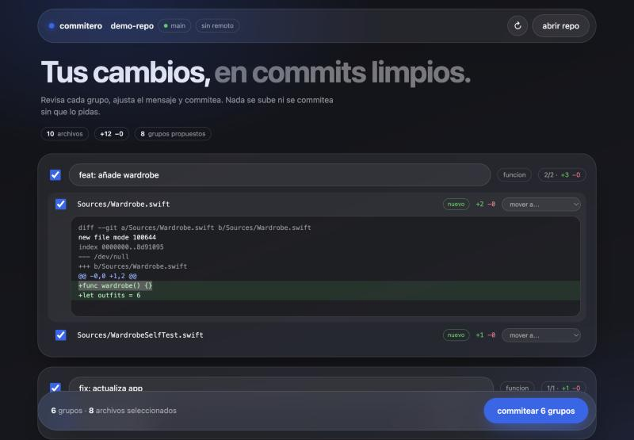
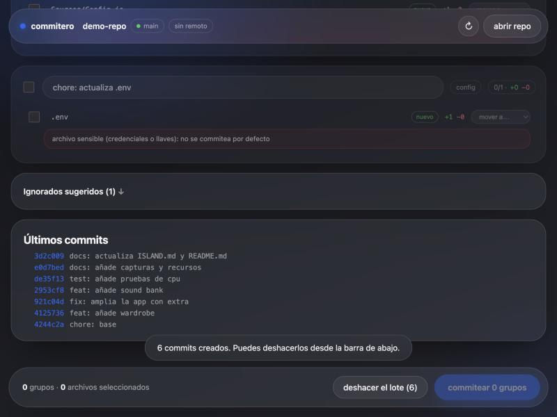

# commitero

agrupa los cambios de un repositorio en commits atómicos, te deja revisarlos y los commitea. pensado para el trabajo con agentes de código: terminan una tarea y dejan veinte archivos sueltos; commitero los ordena en commits que se entienden.


## qué hace

- **agrupa por función**: el código y sus pruebas con el mismo nombre viajan juntos (`Wardrobe.swift` y `WardrobeSelfTest.swift`); la documentación, las capturas, la configuración y las pruebas sueltas van aparte.
- **propone el mensaje** con tus prefijos (`feat:`, `fix:`, `docs:`, `test:`, `chore:`) y lo puedes editar. un cambio pequeño sugiere `fix`, uno nuevo `feat`.
- **te deja revisar**: diff de cada archivo, mover archivos entre grupos, desmarcar lo que no quieres.
- **no commitea secretos**: `.env`, llaves y archivos con claves (AWS, GitHub, `sk-`, llaves privadas) salen desmarcados con un aviso; nunca se muestra el valor completo.
- **nunca atribuye autoría a una IA**: un mensaje con `Co-authored-by`, `Generated with` y similares se bloquea. el autor eres tú.
- **se puede deshacer**: el lote entero se deshace con un `reset` mixto; tus archivos quedan como estaban. no deshace nada que ya esté en el remoto.



## uso

requiere node 20 o más y git.

```sh
node bin/commitero.js /ruta/al/repositorio      # abre la interfaz en el navegador
npm link                                         # opcional: deja el comando `commitero`
commitero                                        # en la carpeta del repositorio
```

opciones: `--port 4747` y `--no-open`.



## seguridad

- solo escucha en `127.0.0.1`; rechaza cualquier `Host` que no sea el local (protección contra DNS rebinding).
- la API exige un token que cambia en cada arranque y viaja dentro de la página, no en la URL; las escrituras exigen `Origin` propio y `application/json`.
- solo opera sobre los repositorios que abriste.
- antes de tocar nada valida el plan completo: mensajes, rutas (sin `..`, rutas absolutas ni opciones de git) y archivos con cambios reales.
- no actúa si ya hay cambios en el índice ni durante un merge o rebase. si un commit falla (por ejemplo, un hook), se detiene, deja los anteriores hechos y limpia el índice.
- subir al remoto es un botón aparte que pide confirmación y nunca fuerza.

## pruebas

```sh
npm test
```

54 pruebas con repositorios temporales reales: agrupación, mensajes, secretos, commits, deshacer, remoto y el servidor.

## con claude pet

claude pet puede abrirlo para el proyecto en el que trabaja el agente (menú de la mascota y tarjeta de "terminó"). commitero funciona solo, sin claude pet.

## licencia

[MIT](LICENSE)
